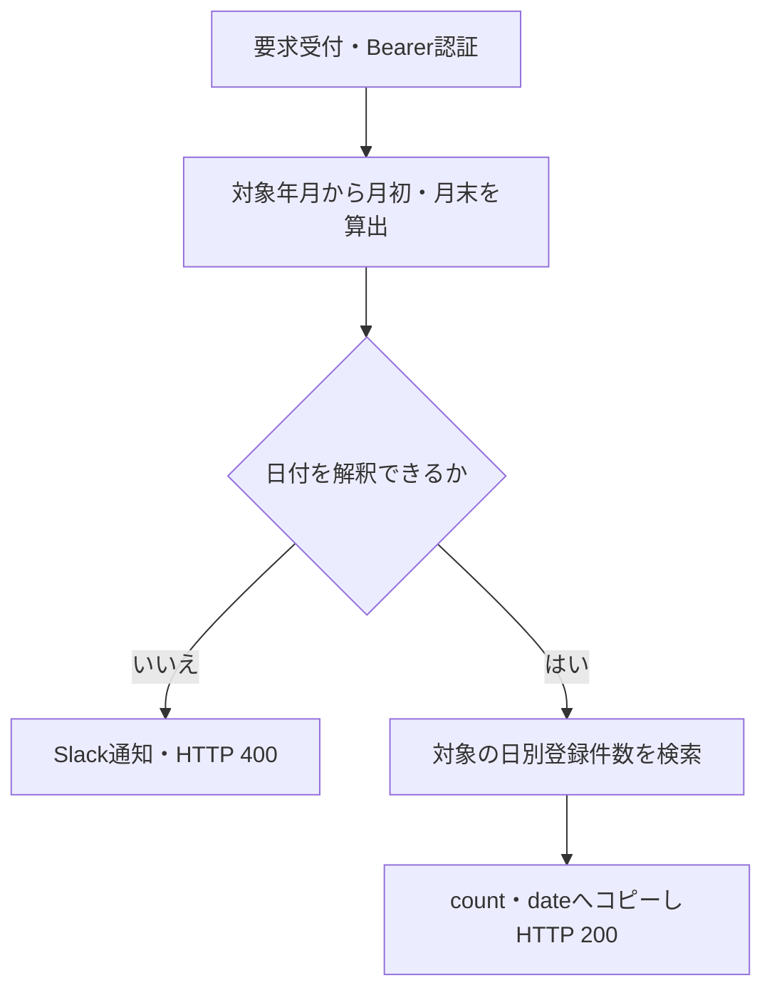
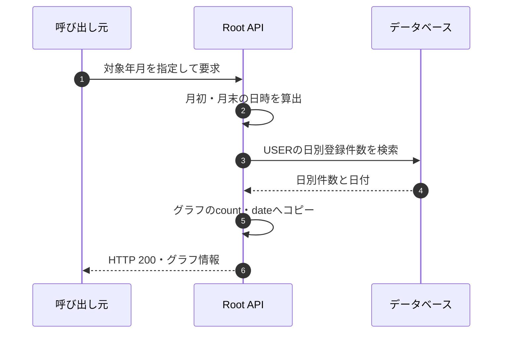

# 設計書 5.9.3. Top情報アカウント情報取得API

## 1. 機能概要

- 対象月の日別登録件数を取得し、Top画面のグラフ情報として返す。
- 入出力の定義は同じフォルダの[OpenAPI](./openapi.yaml)の`rootGetTopAccount`を参照する。

## 2. 処理概要



## 3. IF仕様

### 3.1. HTTPメソッド

| 項目 | 内容 | 備考 |
| --- | --- | --- |
| HTTPメソッド | `GET` | — |

### 3.2. エンドポイントURL

| 項目 | 内容 | 備考 |
| --- | --- | --- |
| エンドポイントURL | `/api/root/top/account` | スキーム・ホスト・ポートは実行環境に従う。パス変数はなし。 |

### 3.3. リクエストIF

#### 3.3.1. リクエストヘッダ

| 項目名 | 型 | 必須 | 値 | 備考 |
| --- | --- | --- | --- | --- |
| `Authorization` | `string` | 必須 | Bearer形式のJWT | `Bearer {JWT}`の形式で、ログインAPIのトークンを指定する。認証失敗はフィルターで処理され、本APIの共通エラー形式を保証しない。 |

#### 3.3.2. クエリパラメータ

| 項目名 | 型 | 必須 | 備考 |
| --- | --- | --- | --- |
| `date` | `string` | 任意 | 基準形式は`yyyyMM`。未指定・空文字・空白のみはシステム日付の月。 |

#### 3.3.3. JSONボディ

特になし。

### 3.4. レスポンスIF

#### 3.4.1. レスポンスヘッダ

| 項目名 | 型 | 設定条件 | 備考 |
| --- | --- | --- | --- |
| `Content-Type` | `string` | 正常なJSON応答時 | `application/json`。本API固有の追加レスポンスヘッダーはない。 |

#### 3.4.2. JSONボディ

```json
{
  "result": "0",
  "account_reg_graph_list": [
    {
      "count": 1,
      "date": "2026/11/01"
    }
  ]
}
```

| 項目名 | 型 | 設定条件 | 備考 |
| --- | --- | --- | --- |
| `result` | `string` | 必須 | 成功は`"0"`、失敗は`"1"`。数値ではない。 |
| `errors[]` | `array<object>` | 異常時 | 各要素の`message`にエラー詳細を設定する。正常時は省略する。 |
| `account_reg_graph_list[]` | `array<object>` | 正常時 | 日別登録件数。0件なら空配列。 |
| `account_reg_graph_list[].count` | `integer`（`int32`） | 正常時 | 登録件数。 |
| `account_reg_graph_list[].date` | `string` | 正常時 | `yyyy/MM/dd`。 |

## 4. 処理フロー



| 番号 | 処理内容 | 関連項番 | 備考 |
| --- | --- | --- | --- |
| 1 | Bearer認証後に要求を受け付ける | 4.3 | dateは任意。 |
| 2 | 対象月の検索範囲を作成する | 4.1 | 未指定・空文字・空白のみはシステム日付の月。 |
| 3 | 検索範囲内の登録件数を集計する | 4.2.1 | REG_DATEを使用。 |
| 4 | 集計結果を受け取る | 4.2.1 | 日付昇順。 |
| 5 | 対象のグラフ配列を編集する | 4.4 | 対象外グラフは省略。 |
| 6 | 正常応答を返す | 3.4.2 | 空の検索結果は空配列。 |

### 4.1. 入力チェック

| 対象 | ルール | 異常時 |
| --- | --- | --- |
| `date`未指定・空文字・空白のみ | システム日付の月を使用する | — |
| 非空の`date` | 末尾に`01`を付け、`uuuuMMdd`の厳密な日付として解釈する。非空値の前後空白は除去しない | 400・`date format error. date is yyyymm` |
| 検索開始・終了 | 対象月1日00:00:00から月末23:59:59まで。両端を含む | — |

| 発生条件 | HTTPステータス | errors[].message | 備考 |
| --- | --- | --- | --- |
| 対象年月の変換失敗 | 400 | `date format error. date is yyyymm` | WARNログとRoot用Slack通知後、`result="1"`と`errors`を返す。 |
| 引数・パスの型変換失敗 | 400 | `{引数名} is type error. value={値}` | `result="1"`と`errors`を返す。 |

### 4.2. DB操作

#### 4.2.1. USERの集計

```sql
SELECT
    DISTINCT DATE_FORMAT(U.REG_DATE, '%Y-%m-%d') AS DATE
    , CNT.COUNT AS COUNT
FROM
    USER U
    , (
        SELECT
            COUNT(REG_DATE) AS COUNT
            , DATE_FORMAT(REG_DATE, '%Y%m%d') AS REG_DATE
        FROM
            USER
        GROUP BY
            DATE_FORMAT(REG_DATE, '%Y%m%d')
    ) AS CNT
WHERE
    U.REG_DATE BETWEEN :from AND :to
    AND DATE_FORMAT(CNT.REG_DATE, '%Y%m%d') = DATE_FORMAT(U.REG_DATE, '%Y%m%d')
ORDER BY
    DATE_FORMAT(U.REG_DATE, '%Y-%m-%d');
```

| 条件・項目 | 内容 | 備考 |
| --- | --- | --- |
| 対象テーブル | `USER` | 全ユーザ分を対象とする。 |
| 期間条件 | `REG_DATE BETWEEN :from AND :to` | 月初00:00:00から月末23:59:59まで、両端を含む。 |
| 集計 | `REG_DATE`の日付ごとの件数 | DBのCOUNTとDATEを返す。 |
| 削除状態 | DELETE_FLAG条件なし | 削除済みを含めて集計する。 |
| 並び順 | 登録日昇順 | 0件の日の補完は行わない。 |

| 発生条件 | HTTPステータス | errors[].message | 備考 |
| --- | --- | --- | --- |
| 業務・外部連携のBaseException | 500 | `application error.` | `result="1"`と`errors`を返す。 |
| DB検索・更新中のその他の例外 | 500 | `unexpected error.` | `result="1"`と`errors`を返す。 |

### 4.3. 認証・共通処理

| 処理 | 内容 | 備考 |
| --- | --- | --- |
| Bearer認証 | 共通フィルターで署名付きJWTを処理する | コントローラ内で権限コードの照合や追加のユーザ検索は行わない。 |
| フィルター段階の失敗 | フィルター・実行環境の処理に従う | コントローラが返す`result`・`errors`形式の対象外。 |
| コントローラ側の異常応答 | `result="1"`と`errors`を設定する | 各要素の`message`は、入力・DB・外部処理の各節に示す文言。 |
| 例外通知・ログ | 基底コントローラの例外ハンドラーはRoot用Slackへ通知し、サーバログへ出力する | コントローラが直接返す業務判定の400応答では、その例外ハンドラーを経由しない。 |

### 4.4. 集計結果・応答編集

| 項目 | 仕様 |
| --- | --- |
| 集計単位 | 各登録日時の日付ごとの件数 |
| 対象 | 検索範囲内の全ユーザ分。ログイン中のユーザによる絞り込みは行わない |
| 削除状態 | `DELETE_FLAG`による除外条件は設けない |
| 並び順 | 登録日の昇順 |
| データのない日 | 0件の日を補完する処理はない。検索結果がなければ空配列 |
| 応答編集 | 検索結果の`COUNT`と`DATE`を`count`と`date`へコピーする |
| 対象外のグラフ | この操作で検索しないグラフ項目は設定せず、応答から省略する |

| 発生条件 | HTTPステータス | errors[].message | 備考 |
| --- | --- | --- | --- |
| その他の例外 | 500 | `unexpected error.` | `result="1"`と`errors`を返す。 |
