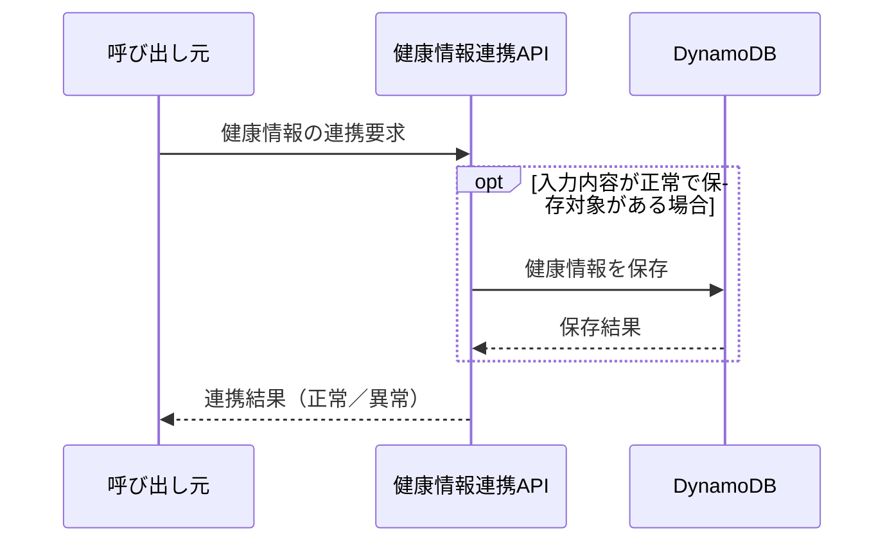
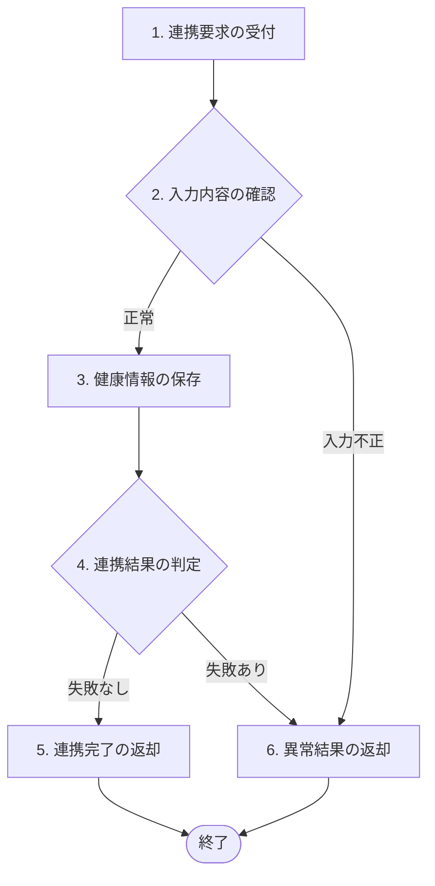

# 設計書 6.0. 健康情報連携API

## 1. 機能概要

- ユーザの健康情報を入力順にDynamoDBへ保存する。
- 要求全体を検証してから処理し、要素単位の失敗は収集して後続を続ける。
- 入出力は[OpenAPI](./openapi.yaml)の`syncHealthInfo`を参照する。

## 2. 処理概要



## 3. IF仕様

### 3.1. HTTPメソッド

| HTTPメソッド | 備考 |
| --- | --- |
| `POST` | - |

### 3.2. エンドポイントURL

| エンドポイントURL | 備考 |
| --- | --- |
| `/api/healthinfo/` | URLのスキーム・ホスト・ポートは実行環境に従う。 |

#### 3.2.1. パスパラメータ

特になし。

### 3.3. リクエストIF

#### 3.3.1. リクエストヘッダ

| 項目名 | 型 | 必須 | 値 | 備考 |
| --- | --- | --- | --- | --- |
| `Content-Type` | `string` | 必須 | `application/json` | リクエストボディをJSON形式で送信する。本API固有の認証ヘッダーは設けない。DRFの共通認証の扱いは「4.7. 認証・共通前処理」に従う。 |

#### 3.3.2. クエリパラメータ

特になし。

#### 3.3.3. JSONボディ

```json
{
  "seq_user_id": 100,
  "health_infos": [
    {
      "seq_health_info_id": 200,
      "height": 170.5,
      "weight": 70.2,
      "bmi": 24.2,
      "standard_weight": 63.6,
      "created_at": "2024/12/01 12:34:56"
    }
  ]
}
```

| 項目名 | 型 | 必須 | 備考 |
| --- | --- | --- | --- |
| `seq_user_id` | `integer` | 必須 | `null`不可。型変換・空文字の扱いは「4.1.2. 項目の検証」に従う。 |
| `health_infos` | `array` | 必須 | `null`不可。要素は`object`。空配列を許可する。要素を指定する場合は各要素の全6項目を必須とする。 |
| `health_infos[].seq_health_info_id` | `integer` | 必須 | `null`不可。型変換・空文字の扱いは「4.1.2. 項目の検証」に従う。 |
| `health_infos[].height` | `number` | 必須 | `null`不可。型変換・空文字の扱いは「4.1.2. 項目の検証」に従う。 |
| `health_infos[].weight` | `number` | 必須 | `null`不可。型変換・空文字の扱いは「4.1.2. 項目の検証」に従う。 |
| `health_infos[].bmi` | `number` | 必須 | `null`不可。型変換・空文字の扱いは「4.1.2. 項目の検証」に従う。 |
| `health_infos[].standard_weight` | `number` | 必須 | `null`不可。型変換・空文字の扱いは「4.1.2. 項目の検証」に従う。 |
| `health_infos[].created_at` | `string` | 必須 | `null`不可。空文字の扱いは「4.1.2. 項目の検証」、日時の形式は「4.3. 日時・数値の変換」に従う。 |

### 3.4. レスポンスIF

#### 3.4.1. レスポンスヘッダ

| 項目名 | 型 | 設定条件 | 備考 |
| --- | --- | --- | --- |
| `Content-Type` | `string` | JSON応答時 | `application/json`。独自のレスポンスヘッダーは定義しない。 |

#### 3.4.2. JSONボディ

```json
{
  "result": 0,
  "synced_at": "2026/11/11 12:00:00"
}
```

| 項目名 | 型 | 設定条件 | 備考 |
| --- | --- | --- | --- |
| `result` | `integer` | 必須 | 成功は数値0、失敗は数値1。 |
| `synced_at` | `string` | 正常時 | 全処理後の連携日時。Asia/Tokyo、YYYY/MM/DD HH:MM:SS。 |
| `error_message` | `object`または`array<object>` | 異常時 | 項目検証では項目ごとのオブジェクト。要素処理ではindex/error/detailの配列。 |
| `error_message[].index` | `integer` | 要素処理失敗時 | 元配列の0始まりの位置。 |
| `error_message[].error` | `string` | 要素処理失敗時 | 固定値unexpected。 |
| `error_message[].detail` | `string` | 要素処理失敗時 | 捕捉した例外の文字列。 |

## 4. 処理フロー



| 処理順 | 処理概要 | 処理詳細 | 関連項番 |
| --- | --- | --- | --- |
| 1 | 連携要求の受付 | 共通前処理とJSON解析を通して要求を受け付け、要求データをログへ記録する。共通前処理や解析で拒否された場合は、その応答で終了する。 | 4.1.1、4.1.3、4.6、4.7 |
| 2 | 入力内容の確認 | 全項目・配列の全要素を検証する。正常なら処理3へ進み、不正なら保存を始めず処理6へ進む。 | 4.1.2 |
| 3 | 健康情報の保存 | 健康情報を保存形式へ変換し、入力順にDynamoDBへ保存する。要素ごとの失敗を収集しながら後続の処理を続ける。空配列の場合は保存を行わず処理4へ進む。 | 4.2、4.3、4.4.1 |
| 4 | 連携結果の判定 | 全要素の処理後に失敗情報を確認する。失敗がなければ処理5、失敗があれば処理6へ進む。 | 4.4.2、4.5.1 |
| 5 | 連携完了の返却 | 成功結果と連携日時を設定し、HTTP 200で返す。空配列も正常完了として扱う。 | 4.5 |
| 6 | 異常結果の返却 | 入力不正の場合は項目ごとのエラー、変換・保存に失敗した場合は要素別のエラーをHTTP 400で返す。成功済みデータは取り消さない。 | 4.1.2、4.4.2 |

### 4.1. 入力チェック

#### 4.1.1. 要求の受け付け

| 入力情報 | 取得元 | 扱い |
| --- | --- | --- |
| ユーザID | JSONボディの`seq_user_id` | 同じ要求内の全健康情報に設定する |
| 健康情報リスト | JSONボディの`health_infos` | 入力された順序で処理する |
| 健康情報の各項目 | `health_infos`の各要素 | 健康情報ID、身長、体重、BMI、標準体重、作成日時を受け付ける |
| 未定義の項目 | JSONボディおよび各要素 | 入力チェック・保存には使用しない |

本API固有のAPIキー照合やユーザ存在チェックは設けない。ユーザIDは要求の値を保存する。

呼び出し側から送られる`migrate_flg`も未定義項目として扱い、その値による保存先・処理経路の切り替えは行わない。

#### 4.1.2. 項目の検証

健康情報リストを含む要求全体を検証し、成功した場合に保存を開始する。

| 対象 | チェック内容 |
| --- | --- |
| `seq_user_id` | 必須・`null`不可。整数として解釈できること |
| `health_infos` | 必須・`null`不可。健康情報オブジェクトの配列であること |
| 各要素の`seq_health_info_id` | 必須・`null`不可。整数として解釈できること |
| 各要素の`height`・`weight`・`bmi`・`standard_weight` | 全項目が必須・`null`不可。浮動小数点数として解釈できること |
| 各要素の`created_at` | 必須・`null`不可。前後の空白を除去した値が空文字でなく、「4.3. 日時・数値の変換」に従って解釈できること |

| 検証ルール | 内容 |
| --- | --- |
| 数値の範囲 | ユーザID・健康情報ID・健康値について、正数限定や業務上の上限・下限を設けない |
| 配列の件数 | 空配列を許可する。API独自の最小・最大件数を設けない |
| 空配列の結果 | 書き込みを行わず、連携成功として応答する |
| 健康値の関係 | BMI・標準体重は要求値を使用する。身長・体重からの再計算や整合性チェックは行わない |
| エラーの返却単位 | 検出した項目エラーを、項目名および配列の位置に対応する構造で返す |

必須・`null`・空文字・空配列の扱いは、入力定義と[Django REST frameworkのフィールド](https://www.django-rest-framework.org/api-guide/fields/)および[ListSerializer](https://www.django-rest-framework.org/api-guide/serializers/#listserializer)の設定に従う。

| 項目 | 仕様 |
| --- | --- |
| HTTPステータス | `400` |
| 処理結果 | 数値の`1` |
| 詳細 | 入力検証の結果を`error_message`へ設定する |
| 詳細の構造 | 項目名をキーとするオブジェクト。配列内のエラーは要素の位置に対応させて返す |
| 保存への影響 | 要求全体の保存を開始しない |

日時の形式・実在性を検証する処理で失敗した場合のメッセージは、`created_at must be specified in 'YYYY/MM/DD HH:MM:SS' format`とする。必須・型・空文字などのエラーには入力検証の標準メッセージを使用する。

#### 4.1.3. 要求解析

| 発生条件 | HTTPステータス | 扱い | 備考 |
| --- | --- | --- | --- |
| JSONの構文が不正 | `400` | DRFの解析エラーとして詳細を返す | 独自のresult/error_message形式へ変換しない。 |
| 許可されていないHTTPメソッド | `405` | DRFのメソッドエラーとして詳細を返す | 独自のresult/error_message形式へ変換しない。 |
| `Accept`で指定したメディアタイプに対応する応答形式がない | `406` | DRFのコンテントネゴシエーションエラーとして詳細を返す | 独自のresult/error_message形式へ変換しない。 |
| 本文を解釈できないメディアタイプ | `415` | DRFのメディアタイプエラーとして詳細を返す | 独自のresult/error_message形式へ変換しない。 |

| 項目 | 処理・条件 | 備考 |
| --- | --- | --- |
| `Accept`省略 | `*/*`として応答形式を選択する | 未指定だけを理由に406にはしない。 |
| 要求データの読込み・検証で予期しない例外 | 要素単位のtryの対象外 | 本APIで捕捉せずDjango/DRFへ伝播し、保存済みデータを取り消す処理はない。 |

### 4.2. DB操作

#### 4.2.1. SQL

特になし。

#### 4.2.2. DynamoDBの保存先・キー

| 項目 | 設定 |
| --- | --- |
| 保存先 | DynamoDB |
| AWSリージョン | `ap-northeast-1` |
| テーブル名 | アプリケーション設定`HEALTH_INFO_DYNAMODB_TABLE_NAME` |
| パーティションキー | `seq_user_id`（Number） |
| ソートキー | `created_at_epoch`（Number、秒単位） |

`seq_health_info_id`は通常の属性として保存する。健康情報IDが異なっていても、ユーザIDとUnix秒が同じ場合は同じ項目への書き込みになる。

| `APP_ENV` | テーブル名 | 環境変数の扱い |
| --- | --- | --- |
| `local`（デフォルト） | `health_info_local` | テーブル名は固定値を使用する |
| `dev` | `health_info_dev` | `HEALTH_INFO_DYNAMODB_TABLE_NAME`に同名の設定が必須 |
| `prd` | `health_info_prd` | `HEALTH_INFO_DYNAMODB_TABLE_NAME`に同名の設定が必須 |

未対応の環境名、またはdev/prdでテーブル名が未設定・不一致の場合は、設定読み込み時にエラーとする。非local環境では`DJANGO_SECRET_KEY`も必須とする。

#### 4.2.3. 保存データと書き込み

```python
table = boto3.resource("dynamodb", region_name="ap-northeast-1").Table(table_name)
table.put_item(Item=item)
```

保存前の検索や条件式を指定せず、編集した項目を`PutItem`で保存する。同じパーティションキー・ソートキーの組み合わせが存在する場合は、既存項目全体を置き換える。

| DynamoDB属性 | 型 | 設定元・変換 |
| --- | --- | --- |
| `seq_user_id` | Number | 要求のユーザID |
| `created_at_epoch` | Number | 各要素の作成日時をUTCへ変換したUnix秒 |
| `seq_health_info_id` | Number | 各要素の健康情報ID |
| `height` | Number | 検証後の浮動小数点数を`Decimal(str(value))`へ変換 |
| `weight` | Number | 検証後の浮動小数点数を`Decimal(str(value))`へ変換 |
| `bmi` | Number | 検証後の浮動小数点数を`Decimal(str(value))`へ変換 |
| `standard_weight` | Number | 検証後の浮動小数点数を`Decimal(str(value))`へ変換 |
| `created_at` | String | 各要素の作成日時をUTCのISO 8601文字列へ変換 |

| 処理 | 条件・設定値 | 備考 |
| --- | --- | --- |
| 書き込み | 編集した項目を1件ずつPutItemする | 条件式を設けず、同一ユーザID・Unix秒は既存項目全体を置き換える。 |
| 書き込み時の例外 | 要素のindex/error/detailを記録して次へ進む | HTTP400の要素別失敗情報として4.4で返す。適用有無の確認・取り消しは行わない。 |

### 4.3. 日時・数値の変換

#### 4.3.1. 保存用日時への変換

| 項目 | ルール |
| --- | --- |
| 入力の基準形式 | `YYYY/MM/DD HH:MM:SS`。Pythonの`datetime.strptime`へ`%Y/%m/%d %H:%M:%S`を指定して解釈する |
| 入力時のタイムゾーン | アプリケーションの現在のタイムゾーンを付与する。設定値は`Asia/Tokyo` |
| 保存用の日時 | 入力日時をUTCへ変換する |
| 保存用のUnix時刻 | UTC日時の`timestamp()`を整数化し、秒単位の`created_at_epoch`とする |
| 保存用の文字列 | UTC日時の`isoformat()`を`created_at`へ設定する |

入力日時はISO 8601形式ではなく、上表の書式で受け付ける。日時の妥当性やゼロ埋めの許容範囲は`strptime`の解釈に従う。

例：`2024/12/01 12:34:56`は、`created_at`に`2024-12-01T03:34:56+00:00`、`created_at_epoch`に`1733024096`として保存する。

#### 4.3.2. 健康値の数値変換

| 対象 | 変換 | 備考 |
| --- | --- | --- |
| 身長・体重・BMI・標準体重 | 検証済みfloatを`Decimal(str(value))`へ変換する | 任意精度の入力小数表記を保持する保証はない。 |

#### 4.3.3. 要素変換時の異常処理

| 対象 | 変換 | 備考 |
| --- | --- | --- |
| 要素の変換時の例外 | index・固定error=unexpected・str(e)を記録して次へ進む | 書き込み時の例外と同じ要素別形式で4.4へ渡す。 |

### 4.4. 保存結果の判定・部分失敗

#### 4.4.1. 要素ごとの保存・失敗後の継続

| 項目 | 仕様 |
| --- | --- |
| 保存単位 | 健康情報リストの1要素ずつ保存する |
| 保存順序 | 要求の配列順に処理する |
| 保存中の失敗 | 失敗要素を記録し、残りの要素も処理する |
| 成功済みデータ | 他の要素が失敗しても保存結果を取り消さない |
| 要求全体のトランザクション | 複数要素をまとめた原子性は保証しない |
| 同じキーの再送 | 同一ユーザID・同一Unix秒の既存項目を置き換える |
| 同一要求内のキー重複 | 同じキーに対しても、配列順に無条件の`PutItem`を実行する |
| リトライ | アプリケーション独自の再試行処理は設けず、AWS SDKの設定に従う |

#### 4.4.2. 全体結果の判定・失敗情報の返却

| 項目 | 仕様 |
| --- | --- |
| HTTPステータス | `400` |
| 処理結果 | 数値の`1` |
| 詳細 | 失敗要素の情報を配列として`error_message`へ設定する |
| 要素の位置 | 元の`health_infos`における0始まりの`index` |
| エラー種別 | 固定文字列`unexpected` |
| エラー詳細 | 捕捉した例外を文字列化した`detail` |
| 処理継続 | 失敗情報を記録し、次の要素を処理する |
| 例外発生時の保存状態 | 当該項目への書き込みが適用されたかの確認・取り消しは行わない |

失敗情報は保存処理で発生した順に返す。API固有の外部エラーコードは付与しない。応答例は[OpenAPI入出力仕様](./openapi.yaml)を参照する。

### 4.5. 正常応答の生成

#### 4.5.1. 正常応答・連携日時の生成

| 条件・項目 | 処理 | 備考 |
| --- | --- | --- |
| 失敗情報なし | HTTP200、resultは数値0、synced_atを返す | 空配列も同じ形式で成功とする。 |
| synced_at | 全要素の処理後の現在日時をローカル時刻にして整形する | 健康情報のcreated_atではない。 |
| 連携日時 | 全要素の処理後の現在日時をアプリケーションのタイムゾーンへ変換し、`YYYY/MM/DD HH:MM:SS`で返す | 保存用日時の変換とは別に、全要素の処理後に取得する。 |

#### 4.5.2. 応答生成時の異常処理

| 条件・項目 | 処理 | 備考 |
| --- | --- | --- |
| 応答日時作成・返却時の予期しない例外 | 本APIで捕捉せずDjango/DRFへ伝播する | 要素単位のtryの対象外。独自の400形式は保証せず、保存済みデータも取り消さない。 |

### 4.6. 要求ログ

| 項目 | 仕様 |
| --- | --- |
| 要求ログ | 入力検証前に要求データ全体をINFOレベルで出力する |
| 出力先 | コンソールおよび`debug.log` |
| ログディレクトリ | `DJANGO_LOG_DIR`。未指定時は`/var/app/log`を使用し、作成に失敗した場合はプロジェクト配下の`log`を使用する |

本APIの要求ログと、呼び出し元が記録するAPI通信ログは、それぞれのアプリケーションで扱う。

### 4.7. 認証・共通前処理

| 項目・条件 | 扱い | 備考 |
| --- | --- | --- |
| 認証・権限 | DRFの共通設定に従い、現在は匿名要求を許可する | APIキー照合・ユーザ存在確認は設けない。 |
| 認証済みセッションのPOST | セッション認証のCSRF検証を適用する | 拒否時はDRF共通処理の応答であり、独自result/error_message形式に統一しない。 |
