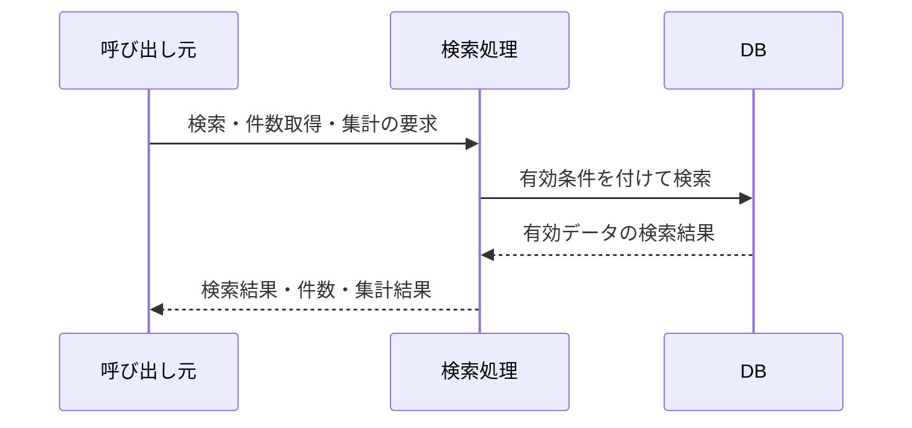
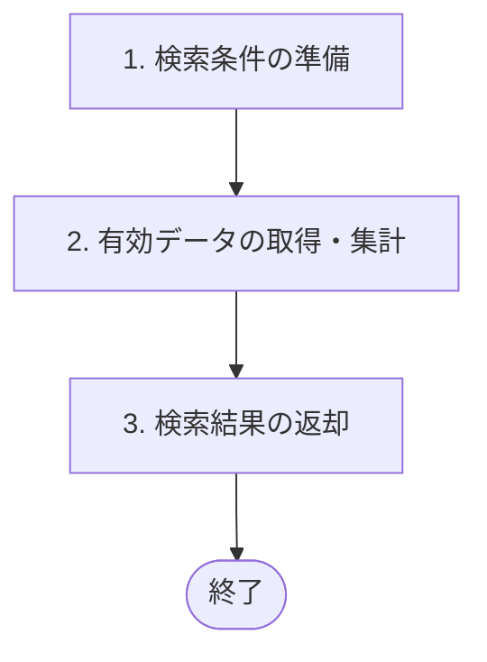

# 共通データ検索仕様

## 1. 機能概要

- `DELETE_FLAG`を持つテーブルの通常検索・件数取得・集計では、有効なデータ（`DELETE_FLAG = false`）だけを対象とする。
- 一覧検索と件数取得で同じ有効条件および利用者の範囲を使用し、ページング結果と総件数を一致させる。
- 結合先のマスタが削除済みの場合はマスタ情報を使用しない。`LEFT OUTER JOIN`では主テーブルの行を残すため、有効条件を`ON`句に指定する。
- 論理削除処理および論理削除済みデータを物理削除するデータパージ処理は、本仕様の対象外とする。

## 2. 処理概要



## 3. 共通検索仕様

### 3.1. 対象テーブル

| テーブル | 主な検索用途 | 有効条件の適用方法 | 備考 |
| --- | --- | --- | --- |
| `USER` | ユーザ取得、件数取得、月次集計 | 主テーブル・集計元の双方に`DELETE_FLAG = false` | ID検索でIDが`null`の場合は該当なしとする。 |
| `HEALTH_INFO` | 健康情報取得、一覧、集計 | 主テーブルに`DELETE_FLAG = false` | 詳細な条件は各健康情報機能の設計書に記載する。 |
| `USER_HEALTH_GOAL` | 目標健康情報取得 | 主テーブルに`DELETE_FLAG = false` | ユーザ情報との結合時も有効な行だけを対象とする。 |
| `USER_RECOVERY_TOKEN` | パスワード再設定トークン取得 | 主テーブルに`DELETE_FLAG = false` | ユーザID、トークン、作成日時の有効期間も条件とする。 |
| `API_LOG` | API通信ログ一覧、件数取得、日次出力 | 主テーブルに`DELETE_FLAG = false` | 一覧と件数取得で同じ条件を使用する。 |
| `BMI_RANGE_MT` | BMI範囲キャッシュ、健康情報との結合 | 単独検索では`WHERE`句、`LEFT OUTER JOIN`では`ON`句に`DELETE_FLAG = false` | 削除済みマスタの場合も健康情報の行自体は残し、BMI範囲項目を未設定とする。 |
| `NEWS_INFO` | お知らせのID検索、一覧、件数取得 | 主テーブルに`DELETE_FLAG = false` | ID検索でIDが`null`の場合は該当なしとする。 |
| `ROOT_LOGIN_INFO` | 管理者サイトユーザのID検索、認証、結合検索 | 主テーブルに`DELETE_FLAG = false` | ID検索でIDが`null`の場合は該当なしとする。 |
| `ROOT_ROLE_MT` | 権限マスタキャッシュ、管理者サイトユーザとの結合 | 単独検索および結合先の双方に`DELETE_FLAG = false` | 指定した権限のうち、有効なマスタだけを返す。0件時に独自のエラー判定は追加しない。 |
| `ROOT_USER_NOTE_INFO` | メモのID検索、一覧、件数取得 | 主テーブルに`DELETE_FLAG = false` | 一覧と件数取得の双方でログインIDを条件とする。ID検索でIDが`null`の場合は該当なしとする。 |
| `INQUIRY_MANAGEMENT` | 問い合わせ一覧、件数取得 | 主テーブルに`DELETE_FLAG = false` | 一覧と件数取得で有効条件を一致させる。 |
| `INQUIRY_STATUS_MT` | 問い合わせステータス選択肢、問い合わせとの結合 | 単独検索では`WHERE`句、`LEFT OUTER JOIN`では`ON`句に`DELETE_FLAG = false` | 単独検索は問い合わせステータスの昇順とする。 |
| `INQUIRY_TYPE_MT` | 問い合わせ種別選択肢、問い合わせとの結合 | 単独検索では`WHERE`句、`LEFT OUTER JOIN`では`ON`句に`DELETE_FLAG = false` | 単独検索は表示順の昇順とする。 |

### 3.2. 検索条件の適用規則

| 検索形態 | 適用規則 | 備考 |
| --- | --- | --- |
| 単一テーブル検索 | `WHERE DELETE_FLAG = false`を指定する | 主キー相当のID検索を含む。 |
| 件数取得 | 対応する一覧検索と同じ有効条件・利用者の条件を指定する | ページングの総件数に削除済みデータや他利用者のデータを含めない。 |
| `INNER JOIN` | `WHERE`句または`ON`句で、削除フラグを持つ結合対象ごとに有効条件を指定する | 管理者サイトユーザと権限の結合検索では、ログイン情報と権限マスタの双方を有効な行に限定する。 |
| `LEFT OUTER JOIN` | 結合先の有効条件を`ON`句に指定する | 結合先が削除済みでも主テーブルの行を除外しない。 |
| 集計 | 集計元と集計結果に再結合する主テーブルの双方に有効条件を指定する | 月次ユーザ登録件数では削除済みユーザを件数および日付一覧の双方から除外する。 |
| キャッシュ | DBからキャッシュへ読み込む時点で有効な行だけを取得する | BMI範囲マスタおよび権限マスタが対象となる。 |

### 3.3. 問い合わせ種別マスタ検索

問い合わせ入力画面の種別選択肢を作成するため、有効な問い合わせ種別マスタを表示順の昇順で取得する。

```sql
SELECT
    INQUIRY_TYPE
    , NAME
    , DESCRIPTION
    , DISP_FLAG
    , DISP_ORDER
    , DELETE_FLAG
    , REG_DATE
    , UPDATE_DATE
FROM
    INQUIRY_TYPE_MT
WHERE
    DELETE_FLAG = false
ORDER BY
    DISP_ORDER ASC;
```

固定条件だけを使用するため、Java側からSQLへ設定する可変値はない。

### 3.4. 検索結果の扱い

| 条件 | 結果 | 備考 |
| --- | --- | --- |
| 有効なデータが存在する | 有効な行だけを呼び出し元へ返す | 一覧の並び順やページングは各機能の設計書に従う。 |
| 削除済みデータだけが存在する | 該当なしとして扱う | エラーまたは空結果の扱いは、呼び出し元の既存仕様に従う。 |
| ID検索でIDが`null` | 該当なしとして扱う | `USER`、`NEWS_INFO`、`ROOT_LOGIN_INFO`、`ROOT_USER_NOTE_INFO`のID検索が対象となる。 |
| `LEFT OUTER JOIN`先だけが削除済み | 主テーブルの行を返し、結合先の項目を未設定とする | 健康情報とBMI範囲マスタの結合などが対象となる。 |

## 4. 処理フロー



| 処理順 | 処理概要 | 処理詳細 | 関連項番 |
| --- | --- | --- | --- |
| 1 | 検索条件の準備 | 呼び出し元のID・期間・ページ情報などを受け取り、検索形態に応じた有効条件を準備する。 | 3.1、3.2 |
| 2 | 有効データの取得・集計 | `DELETE_FLAG = false`を適切な`WHERE`句または`ON`句へ指定し、検索・件数取得・集計を行う。 | 3.2、3.3 |
| 3 | 検索結果の返却 | 有効な検索結果を返す。0件や結合先が未設定の場合の扱いは、各呼び出し元の仕様に従う。 | 3.4 |
